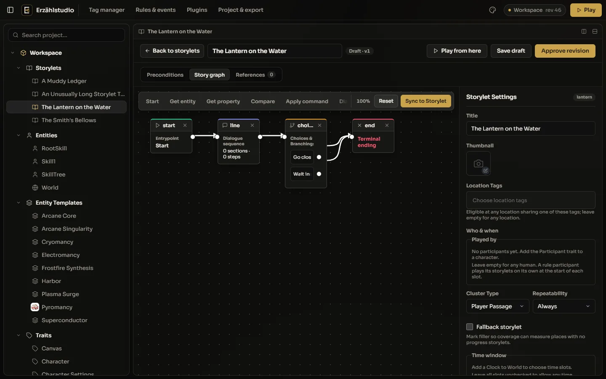
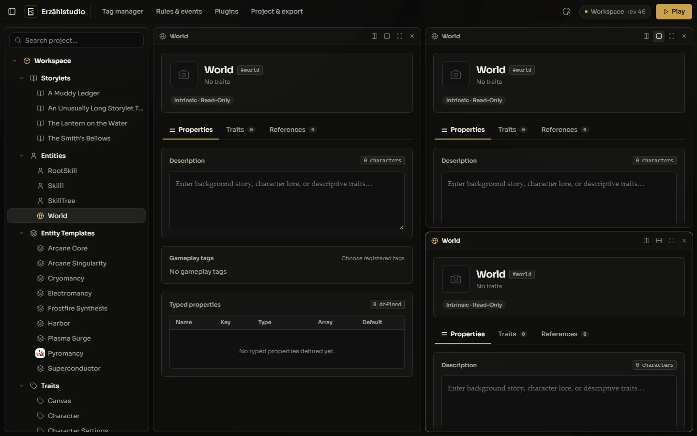
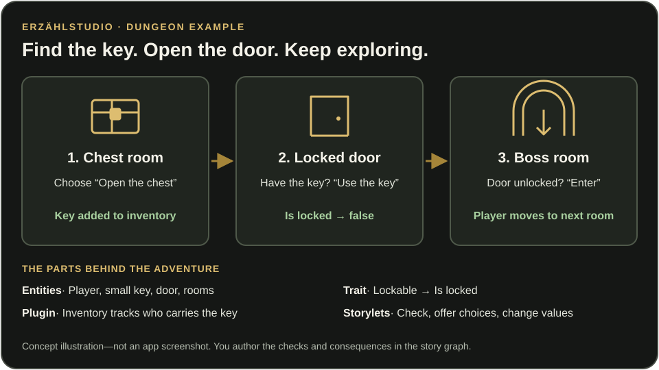

# Erzählstudio

**A place to create worlds where choices matter.**

Erzählstudio aspires to make interactive storytelling feel as natural as imagining a world: bring its people to life, connect their stories, and discover what happens when a player chooses differently.

## Our ambition

Give writers and game makers room to think beyond a single path. From an intimate mystery to a sprawling role-playing world, the goal is stories shaped by characters, knowledge, place, and consequence—not just the next line of dialogue.

Keep the creative process close: imagine, write, arrange, play, reconsider. A calm workspace should help creators see how their stories fit together without taking attention away from the stories themselves.

## Build your world with entities and traits

An **entity** is something in your story world: a person, a place, an item, or a fact. Give it an identity, then describe what matters to your story.

A **trait** is a reusable set of properties. Instead of defining the same details for every character or location, define them once in a trait and give each entity its own values.

For example, a **Lockable** trait adds an *Is locked* property to a door or chest. Each door and chest has its own value: opening one does not unlock the others.

Combine traits rather than forcing everything into one category. A character can also be a merchant or an inventory owner; each trait adds another part of what that entity means in your world.

An **entity template** is a reusable starting point for similar entities. A *Dungeon Door* template can include the **Lockable** trait with *Is locked* set to true. Create an *Entrance Door* and a *Boss Door* from it, then give each door its own values.

## Try it: create dungeon doors

1. In the project tree, open the menu on **Traits** and choose **New Trait**. Name it *Lockable* with the key `lockable`. Under **Typed Properties**, add *Is locked* (`is_locked`, boolean), set it to true, and click **Save**.
2. Open the menu on **Entity Templates** and choose **New Entity Template**. Name it *Dungeon Door*. In its **Traits** tab, select *Lockable* from **Choose trait…**, click **Add**, and **Save**.
3. Open the menu on **Entities** and choose **New Entity**. Name it *Entrance Door* and choose *Dungeon Door* as its **Archetype template**.
4. In its **Traits** tab, set *Is locked* to false and click **Save**. This door starts unlocked.
5. Create a *Boss Door* from the same template and leave *Is locked* true. Both doors share a design, but only one starts locked.

You can also add traits directly to an entity without using an entity template. Use templates for shared starting points, traits for reusable details, and entities for the individual things in your world.

**World** is the studio’s built-in entity, not a character template. Keep your people, places, and items separate from it.

## Let stories respond to the world

A **storylet** is a small playable scene: a conversation, an encounter, a discovery, or a turning point. Rather than putting every scene on one fixed path, you describe when each scene makes sense.

Think of a simple Zelda-style dungeon: **find a key → unlock a door → reach the boss room**.

1. **Find the key.** A storylet in the chest room offers “Open the chest.” That choice gives the player a small key.
2. **Check the door.** Another storylet at the locked door offers “Use the key” only when the player carries it.
3. **Change the world.** That choice sets the door’s *Is locked* property to false.
4. **Continue the adventure.** An unlocked door allows a choice that moves the player into the boss room.
5. **Play and reconsider.** Save and approve the storylet so it can take part in a run. Use **Play** to try your story, rewind to a choice, and explore a different outcome.

You author these checks and consequences in the story graph; adding a trait alone does not make a door behave this way. During play, the studio checks the current world and participants to determine which storylets can happen. Finding the key changes what the player can do next.

## Extend your creative tools with plugins

A **plugin** adds tools to the studio without making every project use them. It can add a new tab on an entity, a more useful way to edit a property, or new kinds of steps in a story graph.

The built-in plugins show what this means in practice:

- **Vector Canvas** gives an entity a visual canvas for maps, notes, and references to people, places, and stories.
- **Inventory** lets you give entities inventories, arrange items, and use story choices to add, remove, or check those items.
- **Tree Graph** lets you arrange connected entities visually—for example, as a skill tree or relationship map.

Open **Plugins** to turn installed tools on or off. Then add the relevant trait to an entity: **Canvas** for a canvas, **InventoryOwner** for an inventory, or **TreeGraph** for a tree. Its extra editor appears as a tab on that entity.

For the dungeon example, give the player entity the **InventoryOwner** trait and the small-key entity the **Item** trait. Use the Inventory plugin’s story-graph steps to give the player the key and check whether they carry it. The plugin provides inventory tools; your story graph decides which door the key opens.

Custom plugins can extend these same authoring tools, but creating one currently requires development work; there is no plugin marketplace or file-install button. Use only plugins you trust.
