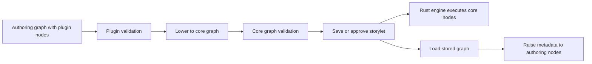

# Studio plugin system

This document describes the current Vue studio implementation, including the **uncommitted temporary canvas-history changes** in the working tree. It is an implementation guide, not a promise of a stable third-party API. Source files are authoritative.

## Purpose and boundary

Plugins add authoring UI and graph-node types to the studio. They run as TypeScript/Vue code in the same browser application as the studio. The deterministic Rust engine does not execute plugin code: the storylet editor lowers plugin nodes into supported core graph nodes before validation and storage. The stored graph carries metadata allowing the editor to reconstruct the authored plugin node.

This is an in-process extension mechanism, not a sandbox, package marketplace, remote plugin protocol, or engine ABI. A plugin has the privileges of studio code and can import application modules, access browser APIs, and call the studio service. Only load trusted code. Plugins are not the external MCP agents described in [the handoff](../HANDOFF.md).

## Source map

| File | Responsibility |
| --- | --- |
| `src/web/studio/plugins/runtime.ts` | Plugin and contribution interfaces, reactive registries, contexts, events, disposal and lookups. |
| `src/web/studio/plugins/manager.ts` | Known-plugin registration, enable/disable, reload and browser preference. |
| `src/web/studio/plugins/index.ts` | Built-in list and one-time installation. |
| `src/web/studio/plugins/graphLowering.ts` | Plugin validation and authoring/core graph conversion. |
| `src/web/studio/views/StoryletEditorView.vue` | Raises on load; validates and lowers on save/approval; emits storylet lifecycle events. |
| `src/web/studio/components/NarrativeGraphCanvas.vue` | Story graph toolbar and menu entries for registered node types. |
| `src/web/studio/views/EntityView.vue` | Entity panel integration. |
| `src/web/studio/components/PropertyListEditor.vue` | Property editor integration. |
| `src/web/studio/plugins/canvas/` | Built-in Vector Canvas plugin and Modify Canvas node. |
| `tests/web/plugins.test.ts` | Runtime, conversion and canvas model tests. |

Paths in this document are relative to the repository root.

## Registration and lifecycle

A `Plugin` has a `name`, optional `description` and `version`, and `apply(ctx)`, which may return a promise. `definePlugin` is a typed identity function; it does not install or isolate the plugin.

The studio's `installBuiltinPlugins()` registers entries from `BUILTIN_PLUGINS` once. The list contains `vectorCanvasPlugin`, `inventoryPlugin`, and `treeGraphPlugin`. Code with access to the application can also call `pluginManager.register(plugin, { builtin: false })`; there is no documented UI for loading arbitrary plugin files. Registration with an existing name is ignored. The Plugins view lists manager entries and their contribution counts and offers enable/disable and reload controls.

The manager keeps disabled plugin names under `dn.studio.disabledPlugins` in browser `localStorage`; storage access is best effort. This setting is per browser, not a project setting. Disabling or unregistering disposes the plugin's context and removes its registrations; it does **not** remove persisted project data or rewrite stored graphs. Re-enabling applies the plugin again.

Each plugin gets a `Context` with an owner name and optional parent. Contributions, listeners, child contexts, and custom cleanup can be attached to it:

- `ctx.entityPanel(...)`, `ctx.propertyEditor(...)`, and `ctx.nodeType(...)` register contributions and return disposer functions.
- `ctx.on(event, listener)` registers an event listener and returns its disposer.
- `ctx.effect(dispose)` registers custom cleanup, for example for an external subscription. If the context is already disposed, cleanup runs immediately.
- `ctx.plugin(plugin)` creates a child context; disposing the parent also disposes the child.
- `ctx.dispose()` runs registered cleanup in reverse order; repeated disposal is harmless.

Registrations are stored in a Vue-reactive `registry`. Components and entries are marked raw. Node type names must be unique among currently registered contributions; duplicate node types throw. Panel and property-editor IDs are not checked for uniqueness by the runtime, so use stable, plugin-qualified IDs to avoid collisions. Property editors are selected by the **first** matching registration. Entity panels are filtered by `appliesTo` and sorted by `order` (default `0`).

**Async limitation:** `ctx.plugin()` starts `loadInto()` without awaiting it. A failed `apply` causes that context to be disposed, but the manager's synchronous `try/catch` is not a reliable way to capture asynchronous apply failures, and it can retain a context reference. Do not treat the manager's enabled/error display as proof that asynchronous initialization completed. Plugins performing async setup should handle expected failures explicitly and make cleanup safe if setup finishes after disposal.

## Contribution contracts

### Entity panel

```ts
ctx.entityPanel({
  id: "example.details",
  label: "Details",
  order: 10,
  appliesTo: (entity) => entity.traits?.some((trait) => trait.template_id === "system.location") ?? false,
  component: DetailsPanel,
});
```

The entity editor renders applicable panels as tabs. The component receives `entity` and `readonly` props and emits `patch` with a partial entity; the host applies the patch to its editor draft. A panel may emit `save` to save the entire current entity draft. It should respect `readonly`. `AnyEntity` covers entity records and entity templates. The existing canvas panel is a concrete example of a panel that edits entity properties.

### Property editor

```ts
ctx.propertyEditor({
  id: "example.property",
  matches: (property) => property.key === "example_data",
  component: ExamplePropertyEditor,
});
```

The declared component contract is `property`, `entity`, `modelValue`, and `disabled`, with an `update:modelValue` event. The current `PropertyListEditor` call site supplies `property`, `modelValue`, and `disabled`; it does **not** pass `entity`. Likewise, its lookup calls `propertyEditorFor(row)` without an entity. Do not depend on that optional argument at this call site. The first matching editor replaces the normal value input.

### Graph node

A `NodeTypeContribution<Config>` supplies:

| Member | Use |
| --- | --- |
| `type`, `label` | Stable unique type key and author-facing label. |
| `category`, `color` | Optional presentation metadata. |
| `defaults()` | Initial config for a new node. |
| `entityInput` | Optional flag exposing an EntityRef data input alongside flow. |
| `itemInput` | Exposes a second EntityRef input for an item. |
| `booleanOutput` | Marks a pure boolean data node without a flow input. |
| `summary?(config)` | Optional node-body summary. |
| `validate?(config, ctx)` | Returns author-facing issue strings. |
| `lower(config, ctx)` | Produces an executable core-node fragment. |
| `inspector` | Optional Vue component receiving `node`, `config`, `graph`; emits `update:config`. |
| `onDelete?(config, node)` | Optional synchronous or asynchronous cleanup when a node is deleted in the editor. |

Registered types are offered in the **Story graph** toolbar and context menu, not the Preconditions graph toolbar. A plugin node stores `plugin_type` and `plugin_config` on an authoring `NarrativeNode`. The deletion callback is notified after confirmation, but the editor does not await it before updating the graph. `pluginNodeDeleted` catches callback errors and logs a warning; cleanup requiring stronger guarantees must account for this behavior.

`LowerContext.id(suffix)` returns `${node.id}__${suffix}` for reproducible fragment IDs; use distinct suffixes. `LowerContext.entity(id)` searches the supplied entity and entity-template array; `graph` and `node` expose the authoring context. Lowering should be deterministic for a given config and graph and return valid engine-supported core nodes and edges. `LoweredFragment.entry` receives incoming flow; `exit` supplies outgoing flow. Optional `inputs` maps authoring data ports to fragment node/port destinations, allowing one incoming edge to fan out. The transform stores original incoming data edges in entry metadata to reconstruct them on raising. Flow remains single-entry/single-exit.

### Events

`ctx.on` and `ctx.emit` use the typed `StudioEvents` map in `runtime.ts`. Dispatch iterates a snapshot of listeners synchronously; the event mechanism does not await promises or provide transaction/rollback semantics. Remove subscriptions through the context lifecycle and catch errors in asynchronous work.

| Event | Payload and current use |
| --- | --- |
| `entity/saved` | Declared with an entity or entity-template payload; no current studio emission site. |
| `workspace/loaded` | No arguments; workspace rows reloaded. Canvas uses it to ensure its trait exists. |
| `storylet/opened` | Storylet ID, or `""` for a new storylet. Emitted after loading the editor's draft. |
| `storylet/saved` | Storylet ID and the **authoring** graph; emitted after a successful save or approval. |
| `storylet/closed` | Storylet ID, or `""` for a new storylet; emitted on editor unmount. |
| `graph/lowered` | Declared with a graph payload; the current lowering function does not emit it. Do not rely on it as a notification. |

Lifecycle events are in-process notifications, not durable events. In particular, a browser crash or forced tab close need not run Vue unmount cleanup.

## Graph persistence and round trip



1. The editor validates each plugin node against the registered contribution. A missing type is an issue; direct lowering also throws for a missing type.
2. Each `lower` result replaces its authoring node. Every fragment member gets `plugin.group`; the entry node additionally gets a JSON copy of the source authoring node, the exit ID, and incoming data edges. Positions are assigned relative to the source node.
3. The editor validates the resulting core story graph and precondition graph, then compiles and saves or approves the storylet. Plugin metadata remains in the stored graph; it is authoring metadata, not plugin execution in Rust.
4. On editor load, `raisePluginGraph` finds groups with source metadata, removes their fragment members and internal group edges, restores the source nodes, and rewrites external connections. It uses metadata rather than invoking the plugin's `lower` function.

Disabling a plugin does not erase lowered data, so the stored core graph remains present. However, the raised authoring node needs its contribution loaded for validation and future saves. Preserve metadata through any graph processing or round-trip editing will not reconstruct the original node. Changing a plugin's config or lowering contract can affect old authored graphs; there is no general plugin migration/version negotiation mechanism in this runtime.

## Worked example: Vector Canvas

`vectorCanvasPlugin` (`name: "vector-canvas"`) demonstrates all three main contribution types:

1. On application and `workspace/loaded`, it checks for the Canvas trait and attempts to create it if a project is loaded and it is absent. Errors are reported with a notification.
2. It adds the **Canvas** entity panel when the entity has the trait and a property summary editor matching `canvas_doc`.
3. It registers `canvas.modify`, the **Modify Canvas** story node, with `ModifyCanvasInspector.vue` and a deletion callback.

The panel edits a layered vector document. The serialized `CanvasDoc` lives in the entity's string property `canvas_doc`; its snapshots contain layers and shapes. Gameplay shapes are markers, entity references and storylet references. `syncCanvasProperties` also maintains `canvas_version`, `map_<shape-id>_present`, marker icon values, and typed reference properties; it replaces the `map_` namespace when rebuilding canvas properties, so plugins should not reuse that namespace for unrelated data. Shapes only present in node versions are declared initially absent. Ordinary edit revisions are capped at 40; node-owned versions are retained separately from that cap. Undo/redo uses an in-memory stack, separate from persisted revision history.

A Modify Canvas node takes an Entity input from a configured **Get Entity** node. Its inspector uses the connected entity's canvas, with no separate entity selector. Direct Get Entity is required because authoring a version needs a specific entity's canvas; unresolved or other entity sources are rejected. Config retains the version's owner, and validation rejects an input changed to a different entity until a new version is saved. Lowering emits an initial `apply_command` that sets `canvas_version`, followed by commands for gameplay differences; the connected entity input fans out to every command. Flow edges chain the commands. Visual-only changes remain in the snapshot rather than becoming individual engine commands. Older lowered canvas nodes are raised with their former implicit Get Entity as an explicit input.

### Temporary canvas history in the current working tree

These behaviors are part of the current uncommitted implementation and may change before integration:

- Saving a new node version writes an `uncommitted` revision; editing a committed version keeps its original snapshot and stores a `draft`. Deleting a committed node marks `pending_delete`; deleting a new uncommitted version removes it immediately.
- Saving or approving the storylet emits `storylet/saved`; the canvas listener queues a scan of affected entity canvases, commits drafts/new versions, and removes pending or absent-node versions. Opening or closing an editor queues discard of that storylet's temporary versions.
- `versionStore.ts` serializes its canvas read-modify-write operations in this browser instance, reads fresh entities from the service, and refreshes workspace rows after changes. Temporary versions are persisted in `canvas_doc`, not just memory. This queue is not a cross-tab lock.
- Storylet persistence and subsequent canvas updates are separate asynchronous operations, not an atomic transaction. The event emitter does not wait for those updates; failures are reported by notification. Abrupt termination can leave temporary data until the relevant cleanup is triggered later.

## Inventory plugin

The built-in inventory plugin provisions `inventory_owner` (displayed as InventoryOwner) and `item` traits. The owner trait stores `rows`, `columns`, and an ordered array of entity references in `items`; the Item trait identifies eligible entities. An owner has an Inventory tab with a 1–20 row and column grid. Each item uses one slot; the panel prevents duplicates, overflow, and shrinking below the number of items. Changes belong to the entity draft until it is saved.

`inventory.add`, `inventory.remove`, and `inventory.has` require owner and item EntityRef inputs, each connected directly to a configured Get Entity node. Studio and service validation check the relevant traits. Add and remove lower to flow nodes; Has lowers to a pure boolean node usable by a Condition Node. During playtest the service projects trait data into runtime-only typed properties, including concrete inventory entities. The engine checks the Item marker, owner inventory, bounds, and capacity; add is idempotent and errors on full, remove is idempotent, and has returns membership. Mutations produce reversible graph diffs. The grid contains unique entity IDs, not stack counts or multi-cell items.

## Tree Graph plugin

The built-in Tree Graph plugin provisions `tree_graph` (displayed as TreeGraph) and `tree_item` (TreeItem) traits. A TreeGraph entity exposes a Tree tab; only entities with TreeItem may be added as nodes. The trait stores `nodes` as typed entity references and `edges` as JSON-encoded `[source, target]` or `[source, target, relationship]` arrays in a string array. Relationship names are nonblank graph metadata, not runtime relationship scores. Edge identity remains the directed endpoint pair. `direction` is one of `right`, `left`, `down`, `up`, or `radial`; `positions` is a JSON string mapping view directions to per-node coordinates. Entity thumbnails are displayed when available.

The Tree panel switches between the canvas and a hierarchical list. List columns come from the `TreeItem` trait template, and edits update each item's matching trait instance. Updates to other entities save independently; an owner that is also a TreeItem is edited in the owner's draft. Failed saves keep pending values for retry or explicit discard. Navigation waits for pending item edits and blocks on invalid or failed changes. A node's first occurrence expands normally; further incoming links and cycles are shown as reference rows without recursively duplicating the graph.

Default TreeItem properties are `level` and `cost` (non-negative integers), `cost_entity` (entity reference), `gameplay_tags_add` and `gameplay_tags_remove` (tag arrays), `description`, `asset`, and `entity` (gameplay entity reference). The gameplay entity is distinct from the graph's directed edges. Existing TreeItem templates receive missing default properties without replacing user-defined fields. Service validation rejects negative level or cost values on saves and bundle imports.

`tree.set_position` and `tree.is_position` accept a TreeGraph owner through a configured Get Entity input. Their inspector shows a read-only tree for choosing a member. Set lowers to a reversible property command; Is lowers to a property read and comparison. Each owner has one initially unset pointer in playtest state. Selecting a destination may jump to any member, including a root or disconnected item; edges do not restrict movement. Authoring and service validation reject non-tree inputs and missing destinations. The authored tree is not modified by execution.

The optional `shapes` property is a JSON string mapping node IDs to `card`, `rounded`, `ellipse`, or `diamond`. It is shared across views and saved with the graph. Node backgrounds use the referenced entity's thumbnail when enabled; thumbnail edits remain on the entity itself. Existing TreeGraph trait templates are extended with the new property on workspace load.

The optional `appearance` JSON string stores the graph's `canvasBackground` color, node background, outline, outline width and dimensions, and wire color, width, and `pattern` (`solid`, `dash`, `dot`, or `brush`). Node styles are keyed by node ID; wire styles are keyed by the JSON-encoded directed endpoint pair. Appearance persists across views and is included in exports. Deleting nodes or wires removes their styles; reconnecting a wire retains its style.

The TreeGraph trait editor exposes graph-wide node and wire defaults instead of raw internal graph fields. Per-node and per-wire settings override these defaults; their context menus can restore the defaults. Canvas background remains graph-wide. Imported CSS is saved with the graph and applies within that graph's canvas; use selectors such as `.tree-node-art` or `.tree-edge` for visual styling. CSS does not update graph geometry, so use the node dimension controls to resize nodes. CSS `@import` is not supported. CSS can load resources referenced by its declarations, so import styles only from sources you trust.

Canvas actions can upload PNG or JPEG images. Images use project-local file references, retain their canvas coordinates and dimensions across views, and render below wires and nodes. Drag an unlocked image or its edge handles to move or resize it. Image and node context menus can lock or unlock their geometry; locked nodes still accept connections. **Save layout** persists these changes. JSON export includes image references, not the image file bytes.

Connections are directed, but can form cycles or share nodes. Roots are nodes without incoming connections; a cyclic component can have no root. The layout uses a deterministic traversal for disconnected and rootless components. Drag the canvas background to pan or use the mouse wheel to zoom; keyboard arrows pan the focused canvas. Switching views preserves graph topology; dragging nodes or using arrow keys adjusts coordinates independently for each view. **Save layout** saves the entire entity draft. **Export JSON** downloads the graph, resolved current layout, and referenced item metadata; it does not export complete entity records or an importable project bundle. The skill-tree, roguelike-map, and relationship-tree examples create actual TreeItem entity templates in the project, then stage the example graph in the owner draft. Service and bundle validation reject missing or ineligible targets, malformed connections, duplicates, and invalid view directions or coordinates. Removing a node also removes its connections and saved positions. This plugin does not implement game-specific unlock or progression rules.

## Adding a plugin

1. Define a uniquely named `Plugin`, choose stable contribution IDs/type keys, and implement `apply(ctx)`. Register all resources through the context, including cleanup for any non-context subscriptions.
2. Add it to `BUILTIN_PLUGINS` or explicitly call `pluginManager.register` from trusted application code. Set `builtin: false` if it should be identified as non-built-in; that flag is metadata, not an isolation boundary.
3. For graph nodes, define defaults, validation, deterministic lowering to valid core fragments, and an inspector if needed. Verify missing entities and incomplete config produce actionable validation errors.
4. Verify save/reopen reconstruction, edge rewiring, deletion, disposal, disabled-plugin behavior, and runtime behavior of the lowered graph. Do not assume disposing a plugin deletes its persisted data.
5. Update the relevant product documentation and tests when changing the contract.

## Verification and troubleshooting

- `bun test tests/web/plugins.test.ts` exercises the existing plugin runtime, canvas model and graph-lowering tests. Read the tests for their exact coverage; they do not by themselves prove all browser lifecycle or persistence cases.
- `bun run typecheck` checks the TypeScript/Vue contracts.
- `bun run test:visual:canvas` builds the UI and runs the canvas browser scenario against a fresh service database; it needs a built service binary and Chromium as described in `tests/visual/canvas-visual.ts`. The current workspace run stopped at the storylet references endpoint with `400 Unsupported reference kind`, before its Modify Canvas checks. Its deletion assertions also describe immediate removal rather than the temporary-history behavior above; update the scenario when that contract is finalized.
- A missing node contribution during validation usually means the plugin is disabled or was not registered. Re-enable it before editing/saving its authoring node; inspect the stored graph and metadata before attempting recovery.
- If a panel is absent, check its `appliesTo` predicate, entity traits and manager state. If a property editor is absent, check the key and registration order. If a canvas version remains temporary, check the storylet lifecycle, notifications, and service writes; a storylet save and the canvas commit are not one atomic operation.
